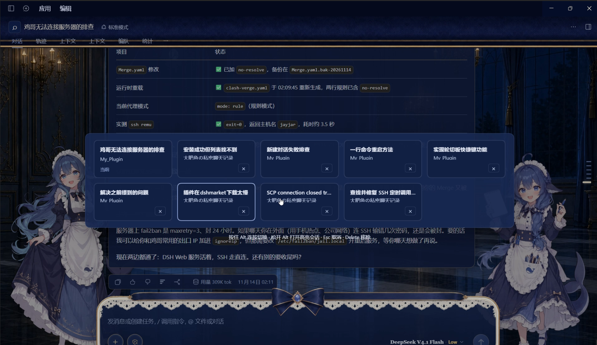
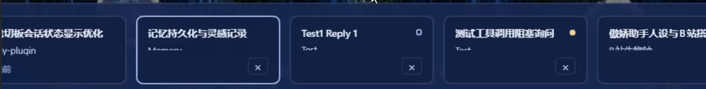
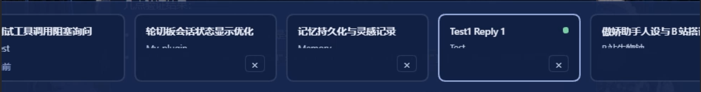

# Remu Desktop Shortcuts

给 [官方 DeepSeek Harness Desktop](https://github.com/deepseek-ai/deepseek-harness)、[社区版 dsh-desktop](https://github.com/anywhere-labs/dsh-desktop) 和浏览器里的 DSH Web 用的快捷键插件：把日常最常做的几个操作绑成自己顺手的键，其中一个还能像 `Alt+Tab` 那样把会话摊成网格，看着选、松手才切。

- **会话轮切板**：按住 `Alt` 连按基础键，所有会话铺成矩形网格，松开 `Alt` 才真正切换。它不接管系统 `Alt+Tab`，也不在桌面铺任何东西，只在自己的 DSH 窗口里工作。
- **会话速切**：一键在最近用过的会话之间轮换，不用回头找侧栏。
- **回到会话 / 聚焦输入框**：从功能页回到聊天，光标直接落进输入框。
- **功能页与开发者工具**：用自己的键切功能页、开 DevTools。



<p align="center">会话轮切板：九张卡片一屏排开，当前会话在左上角并带「当前」标记。</p>

## 适用范围

| 环境 | 说明 |
| --- | --- |
| 官方 DSH Desktop（NEXT / 官方桌面壳） | Windows 实测可用 |
| 社区版 dsh-desktop | Windows 实测可用 |
| 浏览器打开的 DSH Web | Windows + Chrome/Edge 可用，免录制 |

它从来不是系统全局热键，只在 DSH 窗口里生效。macOS / Linux 未做真机验证。

## 快速安装

在 DSH 的 **插件 → 添加插件** 里填入 `kana-desktop-shortcuts`（npm 发布版），或直接用本仓库地址获得最新代码：

```
https://github.com/KhalilJar/Remu-desktop-shortcuts.git
```

安装后点 **立即启用**，按提示重启 Desktop，再到 **设置 → 自定义快捷键** 里录制按键。详细步骤与排查见[安装与第一次使用](#安装与第一次使用)。

## 文档

- [能做什么](#能做什么) — 全部动作一览
- [会话轮切板](#会话轮切板) — `Alt+Q` 的完整行为
- [安装与第一次使用](#安装与第一次使用)
- [兼容与实测](#兼容与实测) — 哪些环境真的验证过
- [更新日志](#更新日志) — 各版本改了什么

## 能做什么

除下方特别注明的固定编号键外，**可录制动作默认都不绑定键位**：你自己选择，冲突时由 DSH 的快捷键服务校验，不改 Enter 发送行为，也不抢系统级快捷键。

| 动作 | 实际效果 | 说明 |
| --- | --- | --- |
| 返回会话 | 从功能页回到**当前会话**，不创建新会话。 | 官方、社区 Desktop 均提供。 |
| 返回会话并聚焦输入框 | 回到当前会话，让光标进入消息输入框，省一次鼠标点击。 | 需要已有会话及可用的输入框。 |
| 聚焦会话内容（方向键滚动） | 将焦点从输入框移到当前会话正文的滚动区，随后可用方向键正常滚动。 | 不切换会话，也不改正文。 |
| 速切最近会话（连按轮换） | 按一次切到下一会话；约 **1.8 秒**内连按，在当前可见的普通会话中继续轮换。 | 列表也可能包括可见但尚未访问的会话；不跳到归档会话或子 Agent 会话。 |
| 返回上一个会话（往返切换） | 类似 `cd -`：在最近访问过的两个会话间往返。 | 本次页面加载后先访问至少两个会话；重新加载会重置这份临时访问记录。 |
| **会话轮切板**（`Alt+Q` / 反向 / 固定） | 按住 `Alt` 连按基础键，把本次打开过的会话铺成矩形网格；**松开 `Alt`** 才切到高亮那个。 | 只需录一次 `Alt + 普通键`（示例用 `Alt+Q`）。**NEXT / 官方桌面壳 / 社区版 / Windows 上的浏览器 DSH Web** 均可，详见上文[会话轮切板](#会话轮切板)。 |
| 切换到功能页 1～9 | 为每个编号分别录制快捷键；1～8 对应左侧当前功能页顺序，9 对应**最后一个**功能页。 | 目标页尚未出现时不会乱跳；官方 Desktop 也可用录制方式配置。 |
| 开发者工具 | 用自己录制的键切换 DevTools。 | 社区 Stable 2.0.18 使用旧桥，DSH NEXT 2.0.22-next 使用其受控桌面指令；NEXT 的自定义录制和按键打开 DevTools 已在 Windows 实机确认。无桥的官方 Desktop 不显示此动作，请用应用菜单。 |

**另外：社区 Stable 2.0.18 / Windows** 保留固定 `Ctrl+1～8`（按左侧功能页顺序）、`Ctrl+9`（最后一个功能页），无需录制；与已有绑定冲突时不接管。**DSH NEXT 与官方原生 Desktop 不提供这组固定键**，可以给上表中的九个功能页动作分别录制键位。系统 `Alt+Tab` 不受影响。

## 会话轮切板

> 注册条件是「**Windows + 能观察到 `Alt` 松开**」：DSH NEXT、官方桌面壳（0.4.15 起）、社区版 dsh-desktop、以及 Windows 上浏览器打开的 DSH Web 都会出现；macOS/Linux、手机浏览器、以及焦点落在内嵌网页时不会给你留下按了没反应的键位。

### 只录一次：Alt + 一个普通键

在 **设置 → 自定义快捷键** 的最下方，点 **＋ 录制轮切键**，按住 `Alt` 再按一个普通键（例如 `Alt+Q`）。插件会据此派生三个组合：

| 组合 | 作用 |
| --- | --- |
| `Alt+Q` | 打开临时板；按住 `Alt` 反复按，高亮向右移动 |
| `Shift+Alt+Q` | 高亮向左移动（反向） |
| `Ctrl+Alt+Q` | 固定板（松开 `Alt` 也不消失），`Enter` 或点卡片打开 |

**保存是一次性的、原子的**：插件先检查派生出的三个组合有没有被别的动作占用，只要有一个冲突或本身不合法，就**一个都不写**，并在设置页说明冲突，原来的键位保持不变。这比「先保存一半、剩下的让你自己收拾」诚实。

### 临时板：松开 Alt 才真的切过去

- 第一次按下时，高亮的是**上一个访问过的会话**，此时不会发生任何跳转。
- 按住 `Alt` 继续按基础键，高亮在候选之间移动；`Shift+Alt+基础键` 反向。
- **松开 `Alt` 才提交**：高亮的会话被打开，板随即关闭。
- `Esc` 取消；窗口失焦同样取消（不会「猜」你想去哪）；长按不会触发自动重复。

> 这里有一个硬性前提：只有真的能观察到 `Alt` 松开，才允许做「松手即切换」。DSH NEXT 的原生快捷键桥只转发按下、不转发松开，所以插件监听的是页面自己的 `keyup`。而 Windows 的窗口菜单栏还会把 `Alt` 的松开事件截走——因此板子打开期间，插件会临时让 DSH 窗口忽略菜单快捷键，松开才能如实送达页面；关板时立即恢复，不影响你用 `Alt` 唤起菜单。如果焦点落在**内嵌网页**（iframe / webview）里，这条通道不可靠——此时插件**拒绝打开**并给出提示，而不是改用计时器去猜。这就是为什么它宁可不响应，也不假装成功。
>
> **浏览器（0.4.9 起，0.4.11 起免录制）另有几点不同**：浏览器没有窗口菜单来抢 `Alt`，所以不需要那套「预置接管」，松开天然能被读到；但 DSH 的 Web 运行时**既不会派发、也不允许保存只带 `Alt` 的组合**（它担心浏览器把这类按键截走），因此板子的按键由插件在本页直接读取，基础字母从能存下的 `Ctrl+Alt` 行取，取不到就用 `Q`——所以浏览器里**打开就能直接按 `Alt+Q`**，不必先录制。两者的效果一样：按住 `Alt` 移动、松开切换。另外，浏览器里松开基础键只算「再移一格」，**只有松开 `Alt` 才提交**。
>
> **浏览器里 `Alt` 仍可能被系统抢走（0.4.10 起有兜底）**：在 Windows 上单独按下 `Alt` 时，浏览器/系统菜单可能在**按下瞬间**就把后续按键的修饰位清掉，于是 `Q` 到页面时 `altKey` 已经是 `false`。0.4.10 起，插件会记住「刚刚确实按下过 `Alt`」并按手势的起点处理，所以这类按键也能开板。如果连 `Alt` 的**松开**都收不到（板子会卡住的那一类），插件在基础键松开后 400 毫秒自行提交，不会留在屏幕上等你按 `Esc`。真到这一步时，也可以直接改用 `Ctrl+Alt+基础键`：浏览器里它现在等于「临时板」而不是固定板，**松开 `Ctrl` 或 `Alt` 都会提交**，手感与 `Alt+Tab` 一致；要固定板则用 `Ctrl+Shift+Alt+基础键`。

### 固定板：用键盘或鼠标都能干净退出

`Ctrl+Alt+基础键` 打开固定板后，松不松 `Alt` 都不影响它显示。可以继续用基础键/反向键或 `←`/`→` 移动、`Enter` 打开、点击卡片打开、`Esc` 取消、点击板外区域取消。**再次按下 `Ctrl+Alt+基础键` 是「取消」，不会悄悄提交当前高亮**。

### 板上有什么，以及「当前会话」的位置

板子是一块**矩形网格**：每行最多 5 张卡、最多 3 行，会话更多时继续向下排，板子内部纵向滚动。用键盘移动高亮时，板子会自动滚到那张卡，不用碰鼠标。

每张卡片显示会话标题、工作区名称和「当前」标记。**当前正在看的会话固定是第一张，同时它也在移动环里**——像 Windows 的 `Alt+Tab` 一样，绕一圈能回到自己。如果你松手时高亮正好停在当前会话，插件不会重新加载它，等于「什么都没切」，这是有意为之。

候选来自**本次 DSH 启动后真正打开过的会话**（跨工作区），沿用插件原有的过滤：不含子 Agent、不含已归档、不含从未开始的空白草稿。候选不足两个时不弹板，只留一句轻提示，不替你猜。

### 移除候选 ≠ 删除会话

卡片右上角的 `×`（或板子打开时按 `Delete`）只是把这张卡片**从本次启动的候选里拿掉**，绝不会归档或删除真实会话。**「当前会话」那张卡没有 `×`，也删不掉**——它是第一张、是锚点，拿掉它会让整块板子的位置失去意义。被拿掉的会话在你之后**重新访问它**时会自动回到候选里；仅仅重渲染页面不会让它立刻弹回来。重启 DSH 后这份临时移除记录清零。

### 已知边界

- **按住 `Alt` 期间，其它 Alt 组合会短暂静音**。接管是从你按下 `Alt` 那一刻开始的，如果你按的是别的 Alt 组合（且没同时按 `Ctrl`），那一段会被吞掉。松开 `Alt`、按下无关键、或超过 2 秒都会立刻归还。这是让 `Alt+Q` 能用必须付的代价。
- **社区版只能用 `Ctrl+Alt+键` 形的基础组合**。DSH 对 Web 运行时有一条硬规则：只放行含 `Ctrl` 的双修饰键组合，纯 `Alt` 一律拒绝（表现为录制时报「此浏览器暂不支持该组合」）。所以社区版的基础键是 `Ctrl+Alt+Q`，反向 `Ctrl+Shift+Q`，固定 `Ctrl+Alt+Shift+Q`；NEXT 仍然是纯 `Alt+Q`。
- 当前只在 Windows 上启用；macOS/Linux 未做真机验证。
- 打开板时焦点若在输入框里，取消会把焦点还回去；提交则不会（你已经换了会话）。
- 板上不显示消息摘要：插件没有低成本可信来源去取「最近一句」，而全库扫消息代价太大，所以退化为标题 + 工作区。
- 真机按键在 Windows DSH NEXT 上已确认可用；多屏、输入法干扰、以及按键与 DSH 自身方向键处理同时生效时的观感尚未逐一验证。

## 安装与第一次使用

### 推荐：在 Desktop 中安装

1. 打开你实际使用的 DSH Desktop，在侧栏进入 **插件 → 添加插件**；也可以点「添加插件」旁的箭头，选 **安装第三方插件**。如果这里显示不可用，先确认当前 Desktop 使用了可管理插件的 Profile。
2. 在安装框里填入本仓库地址：`https://github.com/KhalilJar/Remu-desktop-shortcuts.git`，点击 **安装**。它接受 Git 地址，不需要把单独的 `client.js` 复制到 DSH 的安装目录。
3. 安装成功后点击 **立即启用**；在已安装插件中确认 `kana-desktop-shortcuts` 已启用。如果界面提示需要重启，就按提示重启 Desktop。
4. 打开 **设置 → 自定义快捷键**，选择动作，点击 **＋ 录制快捷键**；按下希望使用的组合键，确认没有冲突提示。**关闭设置后**，回到 Desktop 内容页实际按一次试试。除了社区 Stable Windows 的固定 `Ctrl+数字`，本插件不会替你预设键位。

> 版本以实际下载到的 `package.json` 与安装器显示的为准；各版本改了什么见文末[更新日志](#更新日志)。仅更新 README 文字不会更新已安装的插件。

### Desktop 安装器拉取 Git 仓库失败？使用本地目录

在仓库页面用 **Code → Download ZIP** 下载并解压，或者在装有 Git 的终端执行：

```powershell
git clone https://github.com/KhalilJar/Remu-desktop-shortcuts.git
```

这条命令把仓库下载到当前目录下的 `Remu-desktop-shortcuts` 文件夹。然后回到上面的 **添加插件**，填入**解压/克隆后的完整目录绝对路径**——即同时包含 `package.json` 和 `cordis.patch.yml` 的文件夹，不是其中某一个文件。安装源或 GitHub 连接失败时，本地目录方式不需要由 DSH 再去下载该仓库；若安装器报告依赖脚本需要授权，请先看清具体包名和风险，不要盲点批准。安装本地旧版也不会凭空获得 0.4.5 的 NEXT DevTools 与录制控件修复。

如果你习惯命令行，Desktop 自带的「打开 DSH 终端」也提供 `dsh plugin add <Git 地址或本地绝对路径>`；**先用图形界面更容易看见安装失败原因和启用状态**。不要把普通终端里的另一套 DSH CLI 当作当前 Desktop Profile 的安装器。

### 升级或排查

- **设置页没出现**：确认装在正在使用的 Desktop Profile、插件已启用，并按安装器提示重载/重启；不要只看“安装成功”。**浏览器版需要 0.4.9 以上**，旧版在 Web 里不会注册任何动作。
- **提示“快捷键配置不可读取”**：先检查插件版本。0.4.0/0.4.1 的新增功能页动作 ID 曾与官方原生 Desktop 的校验规则不兼容；0.4.2 起已修复。**不要为排查直接清空键位或点“恢复默认”。**
- **键位保存了但按下没反应**：先关闭设置或菜单，让 DSH 主窗口获得焦点；检查冲突提示，以及组合键是否被操作系统抢先处理。独立 DevTools 窗口、其他应用或内嵌网页不是本插件的热键作用范围。
- **从社区 Stable 2.0.18 升到 DSH NEXT 2.0.22-next 后键位不见了**：有用户实测插件键位与 DSH 内置键位一起恢复默认，重新绑定后可用。旧版快捷键实际使用 Electron 页面 `localStorage`；NEXT 改用原生 Desktop 的 `keybindings.json`，且该产品未提供 Stable/Beta 数据迁移。**这不证明旧数据已被删除**。保留原六个动作 ID 不等于跨产品自动搬运键位；请在 NEXT 中检查并重新录制，别直接复制旧存储或清空新配置。
- **从社区版切到官方版后键位不见了**：不同 Desktop/Profiles 的快捷键存储也不一定相同，需要在各自环境检查并录制。插件不主动迁移或清除旧绑定；若曾在 0.4.0/0.4.1 给新增九个功能页动作录过键，因 ID 已修正，这九项需要重新录制。
- **更新插件**：在插件页核对当前版本和来源；第三方 Git/本地安装不保证自动获得新代码。按插件管理器的升级提示操作，必要时先记下自己的键位，再卸载旧包、安装新版并启用；不同 Profile 要分别处理。

## 兼容与实测

这不是「所有 DSH、所有系统、所有组合键都保证生效」的承诺。以下是**已经观察到的范围**，不是仅凭单元测试推测：

| 环境 | 已有证据 | 尚未保证 |
| --- | --- | --- |
| 社区版 Windows Desktop 增强模式 | 早期版本的原六项与固定 `Ctrl+1` 获用户实际按键确认。 | 新版所有组合键并未逐一复测。 |
| 社区版 Windows Desktop 兼容模式 | 0.4.1 起用户确认设置页出现、原有“返回并聚焦输入框”键位生效。 | DevTools 与所有固定编号键尚未逐一实测。 |
| 社区版 Windows Desktop 扩展模式 | 用户截图确认设置页及旧绑定可见，并反馈已测试键位生效。 | 每个动作和固定编号键未逐一实测。 |
| DSH NEXT 2.0.22-next / Windows | 0.4.3 的普通动作用户重新录制后可用；0.4.5 的“开发者工具”已在插件设置页持续录制、保存/修改，关闭设置后按键实际打开 DevTools；同一动作也出现在 DSH 自带快捷键弹窗。**0.4.6 的会话轮切板已实际按下并完成轮切。** | 其他键位未逐一复测；旧 Stable 的固定 `Ctrl+数字` 不会在 NEXT 接管。 |
| 官方 Windows DSH Desktop 0.2.2-rc.3 | 0.4.2 起用户确认配置可读、录制可用，录制的“返回并聚焦输入框”从功能页触发成功。**0.4.15 的官方壳轮切板已在真机确认**：不录制时按住 `Alt` 连按 `Q` 能一直走到第 3、4 个会话、松开 `Alt` 才切；**0.4.16 起设置页不再提供录制**，因为录制会让原生分发截走按键、`Alt+Q` 失效。 | 官方原生环境不显示社区 DevTools 动作；九个功能页动作尚未逐一实测。 |
| macOS / Linux Desktop | 按相应环境的桥接与快捷键校验能力尝试降级。 | 暂无真机验证；允许的组合和实际送达可能不同。 |
| 普通 DSH Web（浏览器打开服务器上的 DSH） | 0.4.9 起注册会话速切、返回会话、聚焦输入框、功能页与**会话轮切板**（Windows 浏览器）；不再需要桌面桥。0.4.10 起轮切板能识别被系统抢走修饰位的 `Alt`、`Alt` 松开丢失时自动提交，功能页固定键为 `Ctrl+Alt+1～9`；0.4.11 起**免录制，直接按 `Alt+Q` 即可开板**，录制只写 DSH 能接受的 `Ctrl+Alt` 行。 | 浏览器不会出现「开发者工具」动作；`Ctrl+1～9` 属于浏览器自己的标签页快捷键，插件收不到；Firefox 会把单独的 `Alt` 交给自己的菜单，建议 Chrome/Edge。 |

本地 **0.4.19** 通过 52 项单元测试，其中「会话轮切板」在 NEXT 2.0.22-next **与社区版 dsh-desktop** / Windows 均已获用户实机按键确认（含连续两次、反向键）；浏览器 DSH Web 由同一套测试覆盖（含「一条绑定都没存时 `Alt+Q` 仍开板」），但浏览器端的组合键未逐一实机验收。**这不等于其他模式、系统或全部键位都已验收**。插件依赖 DSH 的 `shortcuts`、`settings.section`、`shell.overlay`、会话、布局、工作区等客户端服务和部分页面结构；未来版本若改动这些接口，仍可能需要适配。

### 如果官方后来内置了同样的功能？

相互重叠时，优先用更稳定的内置实现：移除冲突绑定，或关掉本插件即可。插件依赖 DSH 的 `shortcuts`、`settings.section`、`shell.overlay` 等客户端接口，接口变动时可能失效，升级 DSH 后请留意是否有动作消失。

## 关于这个插件

插件起于一个很小的麻烦：社区版 dsh-desktop 增强模式去掉了窗口上方的灰条，也一并带走了顺手打开 DevTools 的入口。于是先有了「用自己的键打开开发者工具」，之后又陆续补上会话速切、正文聚焦、返回上一个会话，以及把会话摊开来看的「会话轮切板」。功能只做自己每天真会按的，不追求覆盖所有组合键。

## 反馈与一起完善

欢迎在 [Issues](https://github.com/KhalilJar/Remu-desktop-shortcuts/issues) 提你日常想要、但还没有快捷键的动作，也欢迎提交 [Pull Request](https://github.com/KhalilJar/Remu-desktop-shortcuts/pulls)。遇到问题时请附上：**官方/社区版、DSH 与插件版本、操作系统、所用模式、录制的组合键、预期与实际现象**；能给复现步骤更好。请勿上传账号凭据、会话正文或私有配置。

想参与本地验证：在仓库根目录安装 Node.js 后运行 `node --test test/client.test.mjs`（`--test` 使用 Node 自带测试运行器；若你的终端不允许子进程，可直接运行 `node test/client.test.mjs`）；`node --check client.js` 只检查语法，不改你的键位。测试通过不等于你那台机器上的按键一定能触发，最有价值的反馈仍然来自真实使用。

## 更新日志

### 0.4.19

- 修复 0.4.18 在真实 DSH Web 里整块加载失败（`web boot: 1 entry did not activate`）：0.4.18 直接读 `ctx.remote` 收实时错误，但 `remote` 没写进 `inject`，Cordis 的 ctx 代理会**抛错**（`cannot get property "remote" without inject`），`?.` 拦不住，整个插件停在未激活。现在改用 `ctx.inject(['remote'], …)`：服务就绪后再订阅，缺它也只是少一个红点，不会拖垮加载；所有订阅统一包 try/catch。
- 新增一条回归测试：模拟 Cordis 的抛错代理，扫出插件真正访问过的客户端服务，逐一核对是否都在 `inject` 里；少声明就直接失败。

状态点实机效果（上方两张图）：左侧卡片右上角的**黄色圆点**表示有方案/审批在等你回复，**绿色圆点**表示那一轮已经跑完、在等你开下一轮。





### 0.4.18

- 轮切板每张卡片加一个会话状态点，语义与 DSH 侧边栏一致，另外补上两种板子才需要的状态：**黄色**=有方案/审批在等你回复，**空心蓝环**=正在跑，**绿色**=跑完在等你开下一轮，**红色**=这一轮意外中止（`api-session/error` 或回合开着却没在跑），**灰色**=超过 24 小时没有任何动静。
- 板子开着时状态点会自己更新，不用关掉重开。
- 打开某张标红的会话即清除它的中止标记。

### 0.4.17

- 每次按下 `Alt+Q` 都重新从最近访问过的会话开始，像 `Alt+Tab` 一样在两个最近的会话之间往返；此前会沿着上一次的位置继续往后走。
- 网格顺序按「当前会话 + 最近使用」实时排列，第一张永远是当前会话，不再被上一次手势冻结。
- 续走时高亮跟随真正要打开的那张卡，不会停在旧顺序的同一格。

### 0.4.16

- 官方桌面壳的设置页不再提供轮切板录制，改为提示直接按 `Alt + 基础键`。
- 若检测到已录入的轮切绑定，设置页给出警告并可一键移除——录制会让原生快捷键分发接管按键，导致 `Alt+Q` 失效。

### 0.4.15

- 官方桌面壳在没有 NEXT 桌面通道时，轮切板改由页面读取按键；原生通道在场时行为不变，避免双触发。
- 纯 `Alt` 组合无法保存时，从能保存的记录中取字母作为基础键。

### 0.4.13

- `Shift` 恢复为反向移动；板子打开时加 `Shift` 一律后退，固定只在板子关闭时由 `Ctrl+Shift+Alt+基础键` 触发。
- 固定板打开后可直接用基础键移动，不必再按住修饰键。

### 0.4.12

- 浏览器里恢复「松开 `Alt` 才提交」；仅在确实收不到 `Alt` 抬起时走 400 毫秒兜底。
- 修复浏览器内一次点按前进两格的问题。

### 0.4.11

- 浏览器里免录制，直接按 `Alt+Q` 开板；录制只写 DSH Web 允许的 `Ctrl+Alt` 组合。
- 设置页如实显示实际要按的 `Alt + 字母`。

### 0.4.10

- 修好浏览器里单按 `Alt` 被系统菜单清掉修饰位后 `Alt+Q` 失效的问题。
- `Alt` 抬起丢失时自动提交，板子不再卡在屏幕上。

### 0.4.9

- 普通浏览器打开的 DSH Web 也能使用会话速切、返回会话、聚焦输入框与轮切板。

### 0.4.8

- 社区版 dsh-desktop 可用；支持轮切回原会话，修复 `Alt` 抬起丢失问题。

### 0.4.7

- 轮切板改为矩形网格：每行最多 5 张、最多 3 行，更多时纵向滚动。

### 0.4.6

- 首次加入「会话轮切板」。

### 0.4.5

- DSH NEXT 的 DevTools 适配，以及录制控件的修复。

